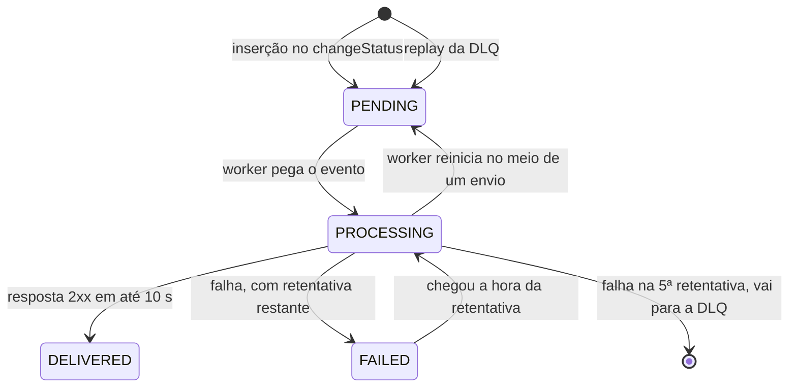

# FDD: Sistema de Webhooks de Notificação de Pedidos

Este documento detalha como implementar a feature proposta no [RFC](RFC.md), em cima das decisões registradas nos [ADRs](adrs/README.md).

## Como ler este documento

Cada afirmação tem uma de três origens:

- **Reunião.** A referência traz o minuto e o falante, como ([09:17] Diego).
- **Código.** A referência traz o caminho de um arquivo que existe no repositório.
- **Proposta.** Ponto que a reunião não definiu e que o código não determina. Vem marcado como **Proposta P-nn** e está reunido na [última seção](#14-propostas-deste-documento-e-questões-em-aberto), para revisão.

Arquivos que ainda não existem aparecem só pelo nome; o diretório em que entram é citado à parte.

## 1. Contexto e motivação técnica

A mudança de status de um pedido acontece hoje em `OrderService.changeStatus` (`src/modules/orders/order.service.ts`), dentro de um único `$transaction`. A aplicação não tem fila nem mecanismo de evento (`package.json`), e os clientes descobrem a mudança consultando a API ([09:00] Marcos).

A reunião fechou a arquitetura, registrada nos ADRs: outbox no MySQL ([ADR-001](adrs/ADR-001-outbox-no-mysql.md)), worker em processo separado com polling ([ADR-002](adrs/ADR-002-worker-em-processo-separado-com-polling.md)), retry com DLQ ([ADR-003](adrs/ADR-003-retry-com-backoff-exponencial-e-dlq.md)), assinatura HMAC-SHA256 ([ADR-004](adrs/ADR-004-assinatura-hmac-sha256-com-secret-por-endpoint.md)), entrega at-least-once ([ADR-005](adrs/ADR-005-entrega-at-least-once-com-x-event-id.md)), reuso dos padrões do projeto ([ADR-006](adrs/ADR-006-reuso-dos-padroes-existentes-do-projeto.md)) e snapshot do payload ([ADR-007](adrs/ADR-007-snapshot-do-payload-na-insercao.md)). Este FDD não repete as justificativas; ele desce ao nível de tabela, fluxo, contrato e arquivo.

## 2. Objetivos técnicos

- Gravar o evento na mesma transação da mudança de status, de modo que os dois confirmem ou sejam desfeitos juntos ([09:06] Diego).
- Ler a outbox a cada 2 segundos, dentro do limite de 10 segundos aceito pelos clientes ([09:02] Marcos; [09:09] Diego).
- Entregar com garantia at-least-once, com um identificador por evento para o cliente deduplicar ([09:24] Diego; [09:25] Diego).
- Assinar cada requisição para o cliente validar origem e integridade ([09:19] Sofia; [09:20] Sofia).
- Retentar entregas com falha por quase 15 horas e, depois disso, mover o evento para uma DLQ com replay manual ([09:15] Diego; [09:17] Diego; [09:18] Diego).
- Seguir a estrutura de módulo, as classes de erro, o logger, o middleware de erro e os schemas Zod que o projeto já usa ([09:30] Larissa).

## 3. Escopo e exclusões

**Incluso:**

- Tabelas da outbox, da DLQ, da configuração dos webhooks e das tentativas de entrega.
- Gravação do evento dentro do `changeStatus`.
- Worker com polling, envio HTTP assinado, retry e DLQ.
- Endpoints de cadastro, edição, remoção e listagem de webhooks, rotação de secret, histórico de entregas e replay da DLQ.

**Excluído:**

| Item | Situação | Origem |
| --- | --- | --- |
| Webhooks de entrada (do cliente para a plataforma) | Fora: o fluxo é só de saída | [09:02] Marcos |
| Garantia exactly-once | Descartada | [09:25] Diego |
| Garantia de ordem global | Sem garantia: limitação conhecida | [09:13] Larissa |
| Vários workers em paralelo | Adiados | [09:13] Diego |
| Arquivamento das linhas entregues da outbox | Fora do escopo desta feature | [09:08] Diego |
| Alerta por email ao cliente | Próxima fase | [09:37] Larissa; [09:48] Larissa |
| Rate limiting de envio | Observar e decidir depois | [09:39] Diego; [09:39] Larissa |
| Painel visual | Fora: só endpoints | [09:40] Larissa |
| Restrição de roles no CRUD de configuração | Aberto a qualquer role autenticada nesta fase: “Mais pra frente a gente pode endurecer.” | [09:37] Sofia |

## 4. Modelo de dados

As tabelas novas seguem o que `prisma/schema.prisma` já faz: id `String @id @default(uuid()) @db.Char(36)`, campos em camelCase e tabela em snake_case via `@@map`. O id da outbox em UUID foi confirmado na reunião ([09:51] Larissa).

| Tabela | Campos | Origem |
| --- | --- | --- |
| `webhooks` (configuração) | `id`, `customerId`, `url`, `secret`, `active`, `statuses`, `createdAt`, `updatedAt` | url, secret, customer_id e estado ativo: [09:21] Bruno, [09:21] Sofia. Lista de status: [09:31] Marcos. Nome da tabela e dos campos: **Proposta P-01** |
| `webhooks` (rotação) | `previousSecret`, `previousSecretExpiresAt` | Secret antiga válida por 24 horas: [09:21] Sofia. Campos: **Proposta P-06** |
| `webhook_outbox` | `id`, `webhookId`, `orderId`, `payload`, `status`, `attempts`, `nextAttemptAt`, `createdAt` | Tabela, evento e status: [09:06] Diego, [09:08] Diego. Payload gravado pronto: [09:52] Larissa. `webhookId`: **Proposta P-02**. `attempts` e `nextAttemptAt`: **Proposta P-03**. `createdAt`: [09:08] Diego. `orderId`: **Proposta P-26** |
| `webhook_dead_letter` | `id`, `webhookId`, `orderId`, `payload`, `failureReason`, `failedAt` | Tabela separada com payload, motivo da falha e timestamp: [09:18] Diego. Nomes dos campos: **Proposta P-01**. `webhookId` e `orderId`: **Proposta P-26** |
| `webhook_deliveries` (tentativas) | `id`, `webhookId`, `eventId`, `attempt`, `success`, `payload`, `responseStatus`, `responseBody`, `durationMs`, `createdAt` | Sucesso ou falha, payload, response e tempo de resposta: [09:34] Marcos. Tabela e campos: **Proposta P-05** |

Detalhes do modelo:

- **Status da outbox.** Os quatro valores ditos na reunião são pendente, processando, falhou e entregue ([09:08] Diego), aqui `PENDING`, `PROCESSING`, `FAILED` e `DELIVERED`. A leitura de `FAILED` é a **Proposta P-04**: a última tentativa falhou e há retentativa agendada. Não é a alternativa descartada no [ADR-003](adrs/ADR-003-retry-com-backoff-exponencial-e-dlq.md): a falha permanente continua indo para a tabela separada.
- **Índices.** A outbox tem índice em `status` e em `createdAt` ([09:08] Diego).
- **Granularidade.** Cada linha da outbox representa um evento para um webhook. Uma mudança de status gera uma linha para cada webhook do cliente inscrito naquele status. O `id` da linha é o identificador do evento, enviado no header `X-Event-Id` (**Proposta P-02**). Neste documento, um evento é esse par de mudança de status e webhook. A reunião falou em uma linha com o evento ([09:06] Diego), e é nesse sentido que os ADRs e o RFC usam o termo.
- **Lista de status.** `statuses` guarda os valores de `OrderStatus` que o webhook quer receber ([09:33] Marcos), em uma coluna `Json`, tipo que o schema já usa em `Customer.address` (**Proposta P-01**).
- **Referências.** `webhooks.customerId` e as colunas `webhookId` têm chave estrangeira. `orderId` é guardado sem chave estrangeira na outbox e na DLQ: o payload é um snapshot, e o pedido pode ser removido depois, já que `OrderRepository.deleteById` apaga a linha (`src/modules/orders/order.repository.ts`). O `eventId` das tentativas também fica sem chave estrangeira, porque a linha da outbox sai da tabela quando o evento vai para a DLQ (**Proposta P-26**).

## 5. Fluxos detalhados

### 5.1 Criação do evento na outbox

O ponto de entrada é o `changeStatus` (`src/modules/orders/order.service.ts`). Bruno propôs uma função `publishWebhookEvent(tx, order, fromStatus, toStatus)`, que recebe o client da transação em curso, sem injetar um repository inteiro no `OrderService` ([09:41] Bruno; [09:41] Diego). O tipo desse client é `Prisma.TransactionClient`, que o arquivo já usa com o apelido local `TxClient`.

1. O `changeStatus` valida a transição, ajusta o estoque quando é o caso, atualiza o pedido e grava o histórico, como hoje (`src/modules/orders/order.service.ts`).
2. Ainda dentro do `$transaction`, depois de gravar o histórico, ele chama `publishWebhookEvent`, exportada pelo módulo de webhooks (**Proposta P-27**).
3. A função busca os webhooks do cliente do pedido inscritos no novo status. Só os ativos entram (**Proposta P-11**).
4. Se não há nenhum, nada é inserido ([09:34] Bruno).
5. Se há, a função monta o payload com os dados do pedido naquele momento ([09:52] Larissa) e insere na outbox uma linha com status `PENDING` por webhook (**Proposta P-02**).
6. Se a inserção falha, a exceção desfaz a transação inteira, e o status não muda ([09:40] Bruno).

O limite de 64 KB do payload, com erro caso ultrapasse ([09:24] Larissa), é verificado no passo 5 (**Proposta P-22**). Como a verificação acontece dentro do `changeStatus`, o erro sai na rota de mudança de status do pedido.

**Limitação conhecida.** Nenhuma transição de pedido leva ao status `PENDING` (`src/modules/orders/order.status.ts`), e a criação do pedido grava o histórico inicial sem passar pelo `changeStatus` (`src/modules/orders/order.service.ts`). Um webhook inscrito no status de pedido `PENDING` nunca dispara.

### 5.2 Processamento pelo worker

O worker é um processo separado da API ([09:11] Diego), com instância própria do `PrismaClient` e a mesma `DATABASE_URL` ([09:30] Bruno). Há um único worker em execução ([09:12] Diego).

1. A cada 2 segundos, o worker busca os eventos pendentes mais antigos ([09:09] Diego), em lote pequeno ([09:08] Diego). Entram também os eventos `FAILED` cuja hora de retentativa chegou (**Proposta P-03**). Diego disse que o worker lê só os pendentes ([09:08] Diego), antes de o retry ser discutido.
2. Os eventos são processados na ordem de `createdAt` ([09:12] Diego), um de cada vez (**Proposta P-23**).
3. O worker marca o evento como `PROCESSING` antes do envio (**Proposta P-04**) e envia a requisição descrita em [6.3](#63-requisição-enviada-ao-cliente), com timeout de 10 segundos ([09:42] Diego).
4. Cada tentativa é registrada em `webhook_deliveries`, com sucesso ou falha, payload, response e tempo de resposta ([09:34] Marcos).
5. Resposta 2xx dentro do timeout é sucesso: o evento vira `DELIVERED` (**Proposta P-13**).
6. Qualquer outro resultado é falha e segue para o [retry](#53-retry).



### 5.3 Retry

A reunião fechou em “5 tentativas” ([09:17] Larissa), lidas como envio inicial mais 5 retentativas ([ADR-003](adrs/ADR-003-retry-com-backoff-exponencial-e-dlq.md)). As esperas são as ditas por Diego ([09:17] Diego):

| Tentativa | Quando acontece |
| --- | --- |
| Envio inicial | No ciclo de leitura seguinte à inserção |
| 1ª retentativa | 1 minuto depois da falha do envio inicial |
| 2ª retentativa | 5 minutos depois da falha anterior |
| 3ª retentativa | 30 minutos depois da falha anterior |
| 4ª retentativa | 2 horas depois da falha anterior |
| 5ª retentativa | 12 horas depois da falha anterior |

A cada falha com retentativa restante, o worker incrementa `attempts`, grava em `nextAttemptAt` a hora da próxima tentativa e marca o evento como `FAILED` (**Proposta P-03**; **Proposta P-04**). No histórico de tentativas, `attempt` 1 é o envio inicial e `attempt` 6 é a 5ª retentativa (**Proposta P-03**).

### 5.4 DLQ e replay

1. Se a 5ª retentativa falha, o evento é considerado falha permanente e é movido para a DLQ ([09:15] Diego).
2. O worker grava em `webhook_dead_letter` o payload, o motivo da falha e o timestamp ([09:18] Diego), e a linha sai da outbox (**Proposta P-04**).
3. O reprocessamento é manual: o endpoint de replay recoloca o evento na outbox como pendente ([09:18] Diego), a partir do payload guardado na DLQ (**Proposta P-14**).
4. O replay exige a role ADMIN ([09:36] Sofia; [09:36] Larissa) e registra em log quem o executou, para auditoria ([09:36] Sofia).
5. O evento recolocado começa um ciclo novo: envio inicial mais 5 retentativas (**Proposta P-14**).

## 6. Contratos públicos

### 6.1 Convenções

| Convenção | Origem |
| --- | --- |
| Todas as rotas ficam sob `/api/v1` | `src/app.ts` |
| Todas exigem `Authorization: Bearer <token>` | [09:32] Larissa; `src/middlewares/auth.middleware.ts` |
| Corpo e resposta em JSON, com campos em camelCase | `src/modules/orders/order.schemas.ts` |
| Erros no formato `{ "error": { "code", "message", "details" } }` | `src/middlewares/error.middleware.ts` |
| Listas paginadas com `page` e `pageSize` (padrão 20, máximo 100), resposta `{ "data", "pagination" }` | `src/modules/orders/order.schemas.ts`; `src/shared/http/response.ts` |
| Criação responde 201, leitura e edição 200, remoção 204 | `src/modules/orders/order.controller.ts` |

### 6.2 Endpoints

| Método e rota | Função | Acesso | Origem |
| --- | --- | --- | --- |
| `POST /api/v1/webhooks` | Cadastra um webhook | Qualquer role autenticada | [09:31] Marcos; [09:37] Sofia |
| `GET /api/v1/webhooks?customerId=` | Lista os webhooks de um cliente | Qualquer role autenticada | [09:33] Bruno; [09:37] Sofia |
| `PATCH /api/v1/webhooks/:id` | Edita um webhook | Qualquer role autenticada | [09:33] Bruno; [09:37] Sofia |
| `DELETE /api/v1/webhooks/:id` | Remove um webhook | Qualquer role autenticada | [09:33] Bruno; [09:37] Sofia |
| `POST /api/v1/webhooks/:id/secret/rotate` | Gera uma secret nova | Qualquer role autenticada (**Proposta P-10**) | [09:21] Sofia. Rota: **Proposta P-08** |
| `GET /api/v1/webhooks/:id/deliveries` | Histórico de entregas | Qualquer role autenticada (**Proposta P-10**) | [09:34] Marcos |
| `POST /api/v1/admin/webhooks/dead-letter/:id/replay` | Recoloca um evento da DLQ na outbox | Role ADMIN | [09:35] Diego; [09:36] Sofia |

A reunião definiu que o identificador do cliente não vem do JWT e vai no body ou no path, sem escolher entre os dois ([09:32] Larissa). Este documento usa `customerId` no body do cadastro e na query da listagem, como `createOrderSchema` e `listOrdersQuerySchema` já fazem em `src/modules/orders/order.schemas.ts` (**Proposta P-07**). A query não está entre as duas formas ditas na reunião; dentro da fala, a alternativa para a listagem seria o path.

#### POST /api/v1/webhooks

Request:

```http
POST /api/v1/webhooks HTTP/1.1
Authorization: Bearer <token>
Content-Type: application/json

{
  "customerId": "0b6f2a4e-6c1d-4a57-9b6e-2f3c8d1e7a10",
  "url": "https://integracao.cliente.example/webhooks/pedidos",
  "statuses": ["SHIPPED", "DELIVERED"]
}
```

Response:

```http
HTTP/1.1 201 Created
Content-Type: application/json

{
  "id": "3b9e6c52-8f0a-4d7b-a1c3-5e2f9d4b7c61",
  "customerId": "0b6f2a4e-6c1d-4a57-9b6e-2f3c8d1e7a10",
  "url": "https://integracao.cliente.example/webhooks/pedidos",
  "statuses": ["SHIPPED", "DELIVERED"],
  "active": true,
  "secret": "9f3c1a7e5b2d4c6f8a0e1b3d5f7a9c2e4b6d8f0a1c3e5a7b9d1f3a5c7e9b0d2f",
  "createdAt": "2026-11-20T13:58:40.000Z",
  "updatedAt": "2026-11-20T13:58:40.000Z"
}
```

- A secret é gerada pela plataforma e devolvida na criação ([09:31] Marcos). Ela só aparece nesta resposta e na de rotação (**Proposta P-09**). Os valores de secret e de assinatura dos exemplos deste documento são ilustrativos.
- A URL precisa ser https; http é recusado ([09:23] Sofia).
- O webhook nasce ativo (**Proposta P-11**).
- Status: `201`; `400` (`VALIDATION_ERROR` ou `WEBHOOK_INVALID_URL`); `401` (`UNAUTHORIZED`); `404` (`WEBHOOK_CUSTOMER_NOT_FOUND`; **Proposta P-24**).

#### GET /api/v1/webhooks?customerId=

Request:

```http
GET /api/v1/webhooks?customerId=0b6f2a4e-6c1d-4a57-9b6e-2f3c8d1e7a10&page=1&pageSize=20 HTTP/1.1
Authorization: Bearer <token>
```

Response:

```http
HTTP/1.1 200 OK
Content-Type: application/json

{
  "data": [
    {
      "id": "3b9e6c52-8f0a-4d7b-a1c3-5e2f9d4b7c61",
      "customerId": "0b6f2a4e-6c1d-4a57-9b6e-2f3c8d1e7a10",
      "url": "https://integracao.cliente.example/webhooks/pedidos",
      "statuses": ["SHIPPED", "DELIVERED"],
      "active": true,
      "createdAt": "2026-11-20T13:58:40.000Z",
      "updatedAt": "2026-11-20T13:58:40.000Z"
    }
  ],
  "pagination": { "page": 1, "pageSize": 20, "total": 1, "totalPages": 1 }
}
```

- `customerId` é obrigatório na query (**Proposta P-07**).
- Status: `200`; `400` (`VALIDATION_ERROR`); `401` (`UNAUTHORIZED`).

#### PATCH /api/v1/webhooks/:id

Request, com os campos a alterar:

```http
PATCH /api/v1/webhooks/3b9e6c52-8f0a-4d7b-a1c3-5e2f9d4b7c61 HTTP/1.1
Authorization: Bearer <token>
Content-Type: application/json

{
  "statuses": ["PAID", "SHIPPED", "DELIVERED"],
  "active": false
}
```

Response:

```http
HTTP/1.1 200 OK
Content-Type: application/json

{
  "id": "3b9e6c52-8f0a-4d7b-a1c3-5e2f9d4b7c61",
  "customerId": "0b6f2a4e-6c1d-4a57-9b6e-2f3c8d1e7a10",
  "url": "https://integracao.cliente.example/webhooks/pedidos",
  "statuses": ["PAID", "SHIPPED", "DELIVERED"],
  "active": false,
  "createdAt": "2026-11-20T13:58:40.000Z",
  "updatedAt": "2026-11-20T15:20:05.000Z"
}
```

- Campos editáveis: `url`, `statuses` e `active` (**Proposta P-11**). Cada webhook escolhe quais status quer receber ([09:33] Bruno; [09:33] Marcos).
- Status: `200`; `400` (`VALIDATION_ERROR` ou `WEBHOOK_INVALID_URL`); `401` (`UNAUTHORIZED`); `404` (`WEBHOOK_NOT_FOUND`).

#### DELETE /api/v1/webhooks/:id

Request:

```http
DELETE /api/v1/webhooks/3b9e6c52-8f0a-4d7b-a1c3-5e2f9d4b7c61 HTTP/1.1
Authorization: Bearer <token>
```

Response, sem corpo:

```http
HTTP/1.1 204 No Content
```

- Status: `204`; `400` (`VALIDATION_ERROR`); `401` (`UNAUTHORIZED`); `404` (`WEBHOOK_NOT_FOUND`).

#### POST /api/v1/webhooks/:id/secret/rotate

Request, sem corpo:

```http
POST /api/v1/webhooks/3b9e6c52-8f0a-4d7b-a1c3-5e2f9d4b7c61/secret/rotate HTTP/1.1
Authorization: Bearer <token>
```

Response:

```http
HTTP/1.1 200 OK
Content-Type: application/json

{
  "id": "3b9e6c52-8f0a-4d7b-a1c3-5e2f9d4b7c61",
  "secret": "c4e8a1f6037b9d2e5a7c0f3b6d9e1a4c7f0b3e6a9d2c5f8b1e4a7d0c3f6b9e2a",
  "previousSecretExpiresAt": "2026-11-21T14:10:00.000Z"
}
```

- A secret antiga continua válida por 24 horas, em paralelo com a nova, e depois deixa de valer ([09:21] Sofia).
- O status `200` e o formato da resposta são a **Proposta P-08**.
- Status: `200`; `400` (`VALIDATION_ERROR`); `401` (`UNAUTHORIZED`); `404` (`WEBHOOK_NOT_FOUND`).

#### GET /api/v1/webhooks/:id/deliveries

Request:

```http
GET /api/v1/webhooks/3b9e6c52-8f0a-4d7b-a1c3-5e2f9d4b7c61/deliveries?page=1&pageSize=20 HTTP/1.1
Authorization: Bearer <token>
```

Response:

```http
HTTP/1.1 200 OK
Content-Type: application/json

{
  "data": [
    {
      "id": "d2a7f1c4-5b8e-4f30-9c6a-1e7b3d5f8a92",
      "eventId": "7c1f0e9a-2b4d-4c68-8a3f-6d5e4c3b2a19",
      "attempt": 1,
      "success": false,
      "payload": { "event_id": "7c1f0e9a-2b4d-4c68-8a3f-6d5e4c3b2a19", "event_type": "order.status_changed" },
      "responseStatus": 503,
      "responseBody": "Service Unavailable",
      "durationMs": 412,
      "createdAt": "2026-11-20T14:03:14.000Z"
    }
  ],
  "pagination": { "page": 1, "pageSize": 20, "total": 1, "totalPages": 1 }
}
```

- Cada item traz sucesso ou falha, payload, response e tempo de resposta ([09:34] Marcos). O payload do exemplo está abreviado.
- O número de “os últimos 100 webhooks”, da fala de Marcos, é tratado como exemplo: a lista usa a paginação do projeto e vem das tentativas mais recentes para as mais antigas, como a listagem de pedidos em `src/modules/orders/order.repository.ts` (**Proposta P-05**).
- Status: `200`; `400` (`VALIDATION_ERROR`); `401` (`UNAUTHORIZED`); `404` (`WEBHOOK_NOT_FOUND`).

#### POST /api/v1/admin/webhooks/dead-letter/:id/replay

O `:id` é o do registro na DLQ. Request, sem corpo:

```http
POST /api/v1/admin/webhooks/dead-letter/a8c3e5f7-1b2d-4e6f-9a0c-3d5e7f9b1c24/replay HTTP/1.1
Authorization: Bearer <token>
```

Response:

```http
HTTP/1.1 200 OK
Content-Type: application/json

{
  "deadLetterId": "a8c3e5f7-1b2d-4e6f-9a0c-3d5e7f9b1c24",
  "status": "PENDING"
}
```

- Exige a role ADMIN, com o `requireRole` que já existe ([09:36] Larissa).
- Registra em log o usuário que executou ([09:36] Sofia).
- O status `200` e o formato da resposta são a **Proposta P-14**.
- Status: `200`; `400` (`VALIDATION_ERROR`); `401` (`UNAUTHORIZED`); `403` (`FORBIDDEN`); `404` (`WEBHOOK_DEAD_LETTER_NOT_FOUND`).

### 6.3 Requisição enviada ao cliente

O worker envia uma requisição `POST` (**Proposta P-12**) para a URL cadastrada:

```http
POST /webhooks/pedidos HTTP/1.1
Host: integracao.cliente.example
Content-Type: application/json
X-Event-Id: 7c1f0e9a-2b4d-4c68-8a3f-6d5e4c3b2a19
X-Signature: 5d41402abc4b2a76b9719d911017c592a3f1c0e8b7d6a5f4e3c2b1a09f8e7d6c
X-Timestamp: 2026-11-20T14:03:14.120Z
X-Webhook-Id: 3b9e6c52-8f0a-4d7b-a1c3-5e2f9d4b7c61
```

```json
{
  "event_id": "7c1f0e9a-2b4d-4c68-8a3f-6d5e4c3b2a19",
  "event_type": "order.status_changed",
  "timestamp": "2026-11-20T14:03:12.000Z",
  "order_id": "5e8d2c1b-9a7f-4b3e-8c6d-0f1a2b3c4d5e",
  "order_number": "ORD-000123",
  "from_status": "PROCESSING",
  "to_status": "SHIPPED",
  "customer_id": "0b6f2a4e-6c1d-4a57-9b6e-2f3c8d1e7a10",
  "total_cents": 15990
}
```

| Header | Conteúdo | Origem |
| --- | --- | --- |
| `X-Event-Id` | UUID do evento, gerado quando ele entra na outbox | [09:25] Diego; [09:44] Diego |
| `X-Signature` | HMAC-SHA256 sobre o corpo do request, com a secret do endpoint | [09:20] Sofia; [09:22] Sofia; [09:44] Diego. Codificação hexadecimal: **Proposta P-12** |
| `X-Timestamp` | Timestamp do envio, para o cliente detectar replay attack | [09:44] Diego. Formato ISO 8601: **Proposta P-12** |
| `X-Webhook-Id` | Id do webhook cadastrado | [09:44] Sofia; [09:45] Diego |
| `Content-Type` | `application/json` | [09:44] Diego |

- **Payload.** Os campos são os ditos por Diego, em snake_case: `event_id`, `event_type`, `timestamp` em ISO 8601, `order_id`, `order_number`, `from_status`, `to_status`, `customer_id` e os campos básicos do pedido, como `total_cents` ([09:43] Diego). Os itens do pedido não vão; quem quiser detalhes consulta o `GET /orders/:id` ([09:43] Diego).
- **Tamanho.** O payload tem limite de 64 KB ([09:24] Larissa).
- **Resposta esperada.** Qualquer status 2xx em até 10 segundos (**Proposta P-13**).
- **Repetição.** O cliente pode receber o mesmo evento mais de uma vez e deduplica pelo `X-Event-Id` ([09:24] Diego; [09:25] Diego).

## 7. Matriz de erros

Os erros do módulo derivam de `AppError` e usam o prefixo `WEBHOOK_` ([09:28] Bruno; [09:29] Larissa).

| Código | HTTP | Quando | Origem |
| --- | --- | --- | --- |
| `WEBHOOK_NOT_FOUND` | 404 | O webhook do `:id` não existe | Código: [09:28] Bruno. Status HTTP: o de `NotFoundError` em `src/shared/errors/http-errors.ts` |
| `WEBHOOK_INVALID_URL` | 400 | A URL não é https | Recusa: [09:23] Sofia. Código: [09:28] Bruno. Status HTTP: o de `BadRequestError` em `src/shared/errors/http-errors.ts`. Onde a regra é verificada: **Proposta P-16** |
| `WEBHOOK_DEAD_LETTER_NOT_FOUND` | 404 | O registro da DLQ do `:id` não existe | **Proposta P-16** |
| `WEBHOOK_CUSTOMER_NOT_FOUND` | 404 | O cliente informado no cadastro não existe | **Proposta P-24** |
| `WEBHOOK_PAYLOAD_TOO_LARGE` | 422 | O payload passa de 64 KB. Sai na rota `PATCH /api/v1/orders/:id/status`, onde o evento é gravado | Limite e erro: [09:24] Larissa. Código e status HTTP: **Proposta P-16**. Momento da verificação: **Proposta P-22** |

Bruno também citou `WEBHOOK_SECRET_REQUIRED` como exemplo ([09:28] Bruno). Depois disso a reunião definiu que a secret é gerada pela plataforma ([09:31] Marcos), então não há entrada em que ela falte. Deixar o código fora da matriz faz parte da **Proposta P-16**.

Erros que chegam dos componentes reaproveitados, sem o prefixo:

| Código | HTTP | Quando | Origem |
| --- | --- | --- | --- |
| `VALIDATION_ERROR` | 400 | Falha de schema Zod no body, na query ou nos params | `src/middlewares/validate.middleware.ts` |
| `UNAUTHORIZED` | 401 | Token ausente, inválido ou expirado | `src/middlewares/auth.middleware.ts` |
| `FORBIDDEN` | 403 | Role diferente de ADMIN no replay | `src/middlewares/auth.middleware.ts` |
| `INTERNAL_SERVER_ERROR` | 500 | Erro não tratado | `src/middlewares/error.middleware.ts` |

O middleware de erro já trata `AppError`, Zod e Prisma, e não precisa mudar ([09:29] Bruno).

## 8. Estratégias de resiliência

| Estratégia | Como funciona | Origem |
| --- | --- | --- |
| Atomicidade | O evento é gravado na transação do `changeStatus`; se a inserção falha, o status não muda | [09:06] Diego; [09:40] Bruno |
| Isolamento | O envio HTTP fica fora da transação, em outro processo | [09:06] Diego; [09:11] Diego |
| Timeout | 10 segundos por chamada; sem resposta, a entrega conta como falha | [09:42] Diego |
| Retry com backoff | 5 retentativas, com as esperas da tabela da [seção 5.3](#53-retry) | [09:17] Diego; [09:17] Larissa |
| DLQ | Esgotadas as retentativas, o evento vai para `webhook_dead_letter`, com payload e motivo da falha | [09:15] Diego; [09:18] Diego |
| Fallback | Não há fallback automático nesta fase: o replay da DLQ é manual, e o email ficou para a próxima fase | [09:18] Diego; [09:48] Larissa |
| Deduplicação | O cliente descarta repetições pelo `X-Event-Id` | [09:25] Diego |
| Reinício do worker | Ao iniciar, o worker devolve a `PENDING` os eventos que ficaram em `PROCESSING` | **Proposta P-15** |
| Encerramento | O worker trata `SIGINT` e `SIGTERM` e desconecta o Prisma, como o servidor faz em `src/server.ts` | **Proposta P-15** |

## 9. Observabilidade

A reunião tratou de log em dois pontos: o projeto usa Pino e nada novo entra ([09:29] Bruno), e o replay registra quem o executou ([09:36] Sofia). Métricas e tracing não foram discutidos, e `package.json` não tem biblioteca para nenhum dos dois. O que segue é a **Proposta P-18** (logs), a **Proposta P-19** (métricas) e a **Proposta P-20** (tracing).

### Logs

Os logs usam o logger de `src/shared/logger/index.ts`, com nome de evento em snake_case, como os `server_started` e `http_request` que o projeto já emite (`src/server.ts`; `src/middlewares/request-logger.middleware.ts`).

| Evento | Onde | Campos |
| --- | --- | --- |
| `webhook_event_recorded` | `publishWebhookEvent` | `eventId`, `webhookId`, `orderId`, `toStatus` |
| `webhook_delivery_succeeded` | worker | `eventId`, `webhookId`, `orderId`, `attempt`, `responseStatus`, `durationMs` |
| `webhook_delivery_failed` | worker | `eventId`, `webhookId`, `orderId`, `attempt`, `failureReason`, `durationMs`, `nextAttemptAt` |
| `webhook_dead_lettered` | worker | `eventId`, `webhookId`, `orderId`, `failureReason` |
| `webhook_dead_letter_replayed` | endpoint de replay | `deadLetterId`, `userId` |
| `worker_started` e `shutdown_initiated` | entry point do worker | `signal`, quando houver |

A secret não é incluída em nenhum log. Como segunda barreira, a lista `redactPaths` de `src/shared/logger/index.ts` cobre senha, token e os headers de autorização e cookie, e ganha `*.secret` e `*.previousSecret`. Do lado do cliente, a reunião registrou um caso de secret vazada em log de aplicação dele ([09:22] Diego).

### Métricas

Sem biblioteca nova, as métricas saem das tabelas e dos logs:

| Métrica | Fonte | Para que serve |
| --- | --- | --- |
| Eventos em `PENDING` e idade do mais antigo | `webhook_outbox` | Acompanhar o limite de 10 segundos ([09:02] Marcos) |
| Entregas com sucesso e com falha | `webhook_deliveries` | Taxa de sucesso por webhook |
| Tempo de resposta do cliente | `webhook_deliveries.durationMs` | O tempo de resposta pedido no histórico ([09:34] Marcos) |
| Eventos em retry | `webhook_outbox` com status `FAILED` | Clientes com indisponibilidade |
| Registros na DLQ | `webhook_dead_letter` | Eventos que dependem de replay manual |

### Tracing

O projeto não tem tracing distribuído. A correlação é feita por identificadores:

- Na API, cada requisição já recebe um `X-Request-Id`, gravado no log `http_request` (`src/middlewares/request-logger.middleware.ts`).
- No worker, todo log leva `eventId`, `webhookId` e `orderId`.
- O `X-Event-Id` segue até o cliente, o que liga o log da plataforma ao recebimento do lado dele.

## 10. Integração com o sistema existente

O [ADR-006](adrs/ADR-006-reuso-dos-padroes-existentes-do-projeto.md) diz o que é reaproveitado. Esta seção diz como cada arquivo existente é usado ou alterado.

| Arquivo existente | Como a feature se integra | Origem |
| --- | --- | --- |
| `src/modules/orders/order.service.ts` | O `changeStatus` chama `publishWebhookEvent(tx, order, fromStatus, toStatus)` dentro do `$transaction`, depois de gravar o histórico (**Proposta P-27**). O client passado é do tipo `Prisma.TransactionClient`, o mesmo que o arquivo entrega aos seus helpers. | [09:40] Bruno; [09:41] Bruno |
| `prisma/schema.prisma` | Ganha os models das quatro tabelas, no padrão de id UUID e `@@map`, e uma migration nova. | [09:51] Larissa |
| `src/app.ts` | O `buildControllers` instancia o repository, o service e o controller do módulo, como faz com os outros. | `src/app.ts` |
| `src/routes/index.ts` | O tipo `Controllers` ganha o controller do módulo, e o `buildApiRouter` monta o router do módulo e o router administrativo do replay. | `src/routes/index.ts` |
| `src/server.ts` | Serve de modelo para o entry point do worker: função de bootstrap, tratamento de sinais e `prisma.$disconnect()`. | [09:11] Larissa |
| `src/config/database.ts` | O worker importa o `prisma` exportado pelo arquivo, como `src/server.ts` faz. Por rodar em outro processo, é outra instância. | [09:30] Bruno |
| `src/config/env.ts` | O worker lê a mesma `DATABASE_URL`. O arquivo também exige `JWT_SECRET` e encerra o processo sem ela, então o ambiente do worker precisa da variável, mesmo sem usá-la. | [09:30] Bruno; `src/config/env.ts` |
| `src/shared/errors/app-error.ts` e `src/shared/errors/http-errors.ts` | As classes de erro do módulo derivam de `AppError`. `BadRequestError`, `ConflictError` e `UnprocessableEntityError` aceitam código customizado; `NotFoundError` tem código fixo, então `WEBHOOK_NOT_FOUND`, `WEBHOOK_DEAD_LETTER_NOT_FOUND` e `WEBHOOK_CUSTOMER_NOT_FOUND` pedem classes próprias, no mesmo arquivo em que está `InsufficientStockError`, reexportadas por `src/shared/errors/index.ts` como as demais (**Proposta P-16**). | [09:28] Bruno |
| `src/middlewares/auth.middleware.ts` | `authenticate` em todas as rotas do módulo; `requireRole('ADMIN')` no replay, como em `src/modules/users/user.routes.ts`. | [09:36] Larissa |
| `src/middlewares/validate.middleware.ts` | Valida body, query e params com os schemas Zod do módulo. | [09:30] Larissa |
| `src/middlewares/error.middleware.ts` | Sem mudança. | [09:29] Bruno |
| `src/shared/logger/index.ts` | Logger do módulo e do worker; `redactPaths` ganha `*.secret` e `*.previousSecret` (**Proposta P-18**). | [09:29] Bruno |
| `src/shared/http/response.ts` | `paginated()` monta a resposta das listagens. | `src/shared/http/response.ts` |
| `package.json` | Ganha o script `worker`. | [09:11] Larissa |
| `tests/setup.ts` | O `beforeEach` limpa as tabelas uma a uma; as quatro tabelas novas entram nessa limpeza, antes de `customer`, de que a tabela `webhooks` depende (**Proposta P-26**). | `tests/setup.ts` |

Arquivos novos:

| Diretório existente | Arquivos novos | Origem |
| --- | --- | --- |
| `src/` | `worker.ts`, o entry point do worker | [09:11] Larissa; [09:28] Bruno |
| `src/modules/` | Pasta `webhooks`, com `webhook.controller.ts`, `webhook.service.ts`, `webhook.repository.ts`, `webhook.routes.ts` e `webhook.schemas.ts` | [09:27] Bruno |
| `src/modules/` | Na mesma pasta, `webhook.processor.ts`, com a lógica de processamento. A reunião deixou o nome entre `webhook.worker.ts` e `webhook.processor.ts` | [09:28] Bruno. Escolha do nome: **Proposta P-17** |

## 11. Dependências e compatibilidade

| Item | Situação | Origem |
| --- | --- | --- |
| Banco | O MySQL que já existe; nenhuma infraestrutura nova | [09:07] Diego |
| Migrations | Feitas com o Prisma, pelo script `db:migrate` | `package.json` |
| Runtime | Node 20 ou superior | `package.json` |
| Cliente HTTP e HMAC | As dependências de runtime de `package.json` não têm cliente HTTP. O worker usa o `fetch` e o módulo `crypto` do próprio Node, sem dependência nova (**Proposta P-21**) | `package.json` |
| Logger | Pino, já presente | [09:29] Bruno |
| Processos | Passam a ser dois: a API e o worker, cada um com o seu script | [09:11] Diego; [09:11] Larissa |
| API existente | Nenhuma rota atual muda de contrato, com uma exceção: o `PATCH /api/v1/orders/:id/status` pode responder `422 WEBHOOK_PAYLOAD_TOO_LARGE` (**Proposta P-22**; **Proposta P-25**). O efeito sobre a remoção de cliente está nas questões em aberto | `src/modules/orders/order.routes.ts` |
| Testes existentes | Rodam contra o MySQL real e dependem da limpeza de `tests/setup.ts`, que precisa conhecer as tabelas novas | `tests/setup.ts` |
| Revisão de segurança | O código de HMAC e de geração de secret passa por revisão antes do deploy | [09:46] Sofia |

## 12. Critérios de aceite técnicos

Esta seção traz os critérios que um teste consegue verificar. Os critérios de aceitação de produto ficam no [PRD](PRD.md).

| # | Critério | Origem |
| --- | --- | --- |
| 1 | Uma mudança de status com webhook do cliente inscrito grava a linha na outbox na mesma transação. | [09:06] Diego |
| 2 | Se a inserção na outbox falha, o status do pedido não muda. | [09:40] Bruno |
| 3 | Sem webhook do cliente inscrito naquele status, nenhuma linha é inserida. | [09:34] Bruno |
| 4 | O payload gravado reflete o pedido no momento da mudança, mesmo que o pedido mude depois. | [09:52] Larissa |
| 5 | O worker roda em processo separado da API e lê a outbox a cada 2 segundos. | [09:09] Diego; [09:11] Diego |
| 6 | A requisição enviada leva `X-Event-Id`, `X-Signature`, `X-Timestamp`, `X-Webhook-Id` e `Content-Type: application/json`. | [09:44] Diego; [09:44] Sofia |
| 7 | A assinatura confere com o HMAC-SHA256 do corpo, calculado com a secret do endpoint. | [09:22] Sofia |
| 8 | Uma chamada sem resposta em 10 segundos conta como falha e entra em retry. | [09:42] Diego |
| 9 | As retentativas seguem as esperas da tabela da [seção 5.3](#53-retry). | [09:17] Diego |
| 10 | Depois da 5ª retentativa com falha, o evento está em `webhook_dead_letter`, com payload e motivo. | [09:15] Diego; [09:18] Diego |
| 11 | O replay sem role ADMIN responde 403; com ADMIN, recoloca o evento como pendente e registra quem executou. | [09:18] Diego; [09:36] Sofia; [09:36] Larissa |
| 12 | O cadastro com URL http é recusado. | [09:23] Sofia |
| 13 | A secret é devolvida na criação e pode ser rotacionada pela API; a antiga vale por 24 horas. | [09:31] Marcos; [09:21] Sofia |
| 14 | Um payload acima de 64 KB gera erro. | [09:24] Larissa |
| 15 | Os erros do módulo usam códigos com o prefixo `WEBHOOK_`. | [09:29] Larissa |
| 16 | O histórico de entregas traz sucesso ou falha, payload, response e tempo de resposta. | [09:34] Marcos |

## 13. Riscos e mitigação

Esta seção traz os riscos de implementação. Os de arquitetura e de segurança estão no [RFC](RFC.md), e os de negócio e de prazo no [PRD](PRD.md).

| Risco | Origem | Mitigação |
| --- | --- | --- |
| A transação do `changeStatus`, que já é pesada, ganha uma leitura dos webhooks do cliente, exigida pelo filtro na inserção ([09:34] Bruno), e uma escrita por webhook inscrito, pela **Proposta P-02**. A reunião tratou de uma linha com o evento, e o [ADR-001](adrs/ADR-001-outbox-no-mysql.md) registra uma escrita. | [09:04] Bruno; [09:34] Bruno; [09:40] Bruno | Índice em `customerId` na tabela `webhooks`, como a tabela `orders` já tem em `prisma/schema.prisma` (**Proposta P-01**). A reunião não tratou do custo adicional. |
| O acúmulo de linhas na outbox pode deixar a leitura do worker lenta, dúvida levantada por Bruno. | [09:07] Bruno | Índices em `status` e `createdAt` e leitura em lote pequeno ([09:08] Diego). O arquivamento ficou fora do escopo ([09:08] Diego). |
| A secret aparece em log da plataforma. | `src/shared/logger/index.ts` | `*.secret` e `*.previousSecret` em `redactPaths` (**Proposta P-18**). |
| Eventos ficam presos em `PROCESSING` se o worker cai no meio de um envio. | **Proposta P-04** | Devolver esses eventos a `PENDING` quando o worker inicia (**Proposta P-15**). |
| A limpeza dos testes existentes falha por chave estrangeira se a tabela `webhooks` não for limpa antes da tabela de clientes (**Proposta P-26**). | `tests/setup.ts` | Incluir as tabelas novas no `beforeEach`, antes de `customer`. |
| Respostas de autenticação e de role saem sem o prefixo `WEBHOOK_`. | `src/middlewares/auth.middleware.ts` | Aceito como limitação dos middlewares reaproveitados, descrita no [ADR-006](adrs/ADR-006-reuso-dos-padroes-existentes-do-projeto.md). |

## 14. Propostas deste documento e questões em aberto

### Propostas

Cada proposta cobre um ponto que a reunião não definiu. A coluna "Motivada por" traz a fala ou o arquivo que tornou a definição necessária.

| # | Proposta | Motivada por |
| --- | --- | --- |
| P-01 | Nomes das tabelas `webhooks` e `webhook_deliveries`, dos campos e dos status em inglês; `statuses` em coluna `Json`; índice em `customerId` na tabela `webhooks`. | `prisma/schema.prisma` |
| P-02 | Uma linha na outbox por webhook inscrito; o `id` da linha é o identificador do evento. | [09:25] Diego; [09:44] Sofia |
| P-03 | Campos `attempts` e `nextAttemptAt` para agendar as retentativas dentro do polling; no histórico, `attempt` 1 é o envio inicial. | [09:09] Diego; [09:17] Diego |
| P-04 | O evento vira `PROCESSING` antes do envio; `FAILED` significa falha com retentativa agendada; esgotadas as retentativas, a linha sai da outbox e vai para a DLQ. | [09:08] Diego; [09:15] Diego; [09:18] Diego |
| P-05 | Tabela `webhook_deliveries`, com uma linha por tentativa de entrega; o histórico é paginado como as outras listas do projeto, da tentativa mais recente para a mais antiga, e “os últimos 100 webhooks” é lido como exemplo. | [09:34] Marcos; `src/modules/orders/order.repository.ts` |
| P-06 | Campos `previousSecret` e `previousSecretExpiresAt` para a janela de 24 horas. | [09:21] Sofia |
| P-07 | `customerId` no body do cadastro e, obrigatório, na query da listagem. | [09:32] Larissa; `src/modules/orders/order.schemas.ts` |
| P-08 | Rotação pela rota `POST /api/v1/webhooks/:id/secret/rotate`, com resposta `200` que traz a secret nova e a validade da antiga. | [09:21] Sofia |
| P-09 | A secret só aparece nas respostas de criação e de rotação. | [09:31] Marcos |
| P-10 | Rotação e histórico de entregas com a mesma regra de acesso do CRUD. | [09:37] Sofia |
| P-11 | O webhook nasce ativo; inativo, não gera eventos novos; `url`, `statuses` e `active` são editáveis. | [09:21] Bruno; [09:21] Sofia; [09:33] Bruno |
| P-12 | Requisição ao cliente por `POST`; `X-Signature` em hexadecimal; `X-Timestamp` em ISO 8601. | [09:44] Diego |
| P-13 | Sucesso é resposta 2xx dentro do timeout; qualquer outro resultado é falha. | [09:42] Diego |
| P-14 | O replay recoloca o evento a partir do payload guardado na DLQ, com um ciclo novo de tentativas, e responde `200` com o id do registro da DLQ e o status `PENDING`. | [09:18] Diego |
| P-15 | Ao iniciar, o worker devolve a `PENDING` os eventos em `PROCESSING`; ao receber `SIGINT` ou `SIGTERM`, encerra como o servidor. | [09:11] Diego; [09:12] Diego; `src/server.ts` |
| P-16 | Códigos `WEBHOOK_DEAD_LETTER_NOT_FOUND` (404) e `WEBHOOK_PAYLOAD_TOO_LARGE` (422); regra de https verificada no service, para responder `WEBHOOK_INVALID_URL`; classes de erro novas no arquivo das classes existentes; `WEBHOOK_SECRET_REQUIRED` fora da matriz. | [09:28] Bruno; [09:29] Larissa; [09:31] Marcos; `src/shared/errors/http-errors.ts` |
| P-17 | Arquivo de processamento com o nome `webhook.processor.ts`. | [09:28] Bruno |
| P-18 | Eventos de log listados na seção 9; `*.secret` e `*.previousSecret` em `redactPaths`. | `src/shared/logger/index.ts` |
| P-19 | Métricas tiradas das tabelas e dos logs, sem biblioteca nova. | `package.json` |
| P-20 | Correlação por identificadores no lugar de tracing distribuído. | `src/middlewares/request-logger.middleware.ts` |
| P-21 | `fetch` e `crypto` do Node, sem dependência nova. | `package.json` |
| P-22 | Limite de 64 KB verificado na inserção; o erro desfaz a mudança de status. | [09:24] Larissa; [09:40] Bruno |
| P-23 | O worker processa um evento de cada vez. | [09:12] Diego |
| P-24 | Cadastro com cliente inexistente responde `404 WEBHOOK_CUSTOMER_NOT_FOUND`. | [09:29] Larissa; `src/modules/orders/order.service.ts` |
| P-25 | Nenhuma rota existente muda de contrato, salvo o `PATCH /api/v1/orders/:id/status`, que ganha o erro da P-22. | `src/modules/orders/order.routes.ts` |
| P-26 | `webhooks.customerId` e as colunas `webhookId` com chave estrangeira; `orderId` guardado sem chave estrangeira na outbox e na DLQ, e `eventId` sem chave estrangeira nas tentativas. | `prisma/schema.prisma`; `src/modules/orders/order.repository.ts` |
| P-27 | `publishWebhookEvent` fica no módulo de webhooks e é chamada depois da gravação do histórico. | [09:41] Bruno |

### Questões em aberto

| Questão | O que há até aqui | Origem |
| --- | --- | --- |
| Código de erro da URL http | A reunião quer a recusa no schema Zod e citou `WEBHOOK_INVALID_URL`. Hoje toda falha de schema sai como `VALIDATION_ERROR`. A P-16 propõe verificar a regra no service. | [09:23] Sofia; [09:28] Bruno; `src/middlewares/validate.middleware.ts` |
| Identificação do cliente: body ou path | A reunião não escolheu. A P-07 propõe body e query. | [09:32] Larissa |
| Tamanho do lote do worker | A reunião disse “batch pequeno”, sem número. | [09:08] Diego |
| Campos básicos do pedido no payload | Diego citou `total_cents` como exemplo e não listou os demais. O exemplo deste documento traz só o campo citado. Também não foi dito se o `timestamp` é a hora da mudança de status ou a da gravação do evento. | [09:43] Diego |
| Eventos de um webhook removido ou desativado | A reunião definiu a remoção e o estado ativo, sem tratar dos eventos já gravados na outbox, na DLQ e no histórico. | [09:21] Bruno; [09:21] Sofia; [09:33] Bruno |
| Remoção de cliente com webhooks cadastrados | `CustomerService.delete` apaga a linha do cliente (`src/modules/customers/customer.service.ts`). Com a chave estrangeira da P-26, a remoção passa a depender do que for decidido para os webhooks desse cliente. | `src/modules/customers/customer.service.ts` |
| Duas rotações de secret em menos de 24 horas | A reunião definiu a janela de 24 horas para a secret antiga. Os campos da P-06 guardam uma secret anterior só. | [09:21] Sofia |
| Registro da DLQ depois do replay | A reunião não disse se ele permanece, é marcado ou é removido. | [09:18] Diego |
